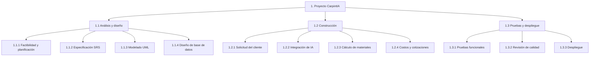
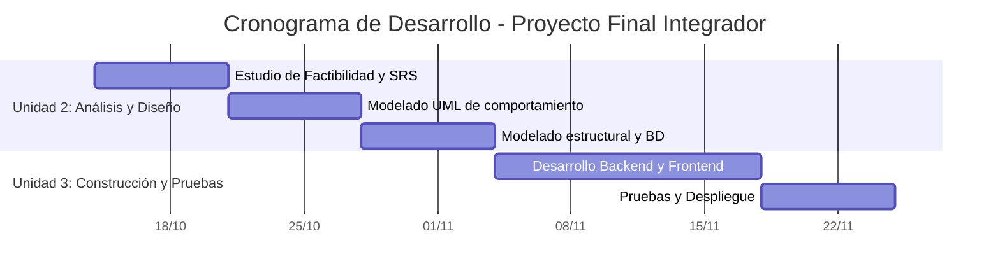
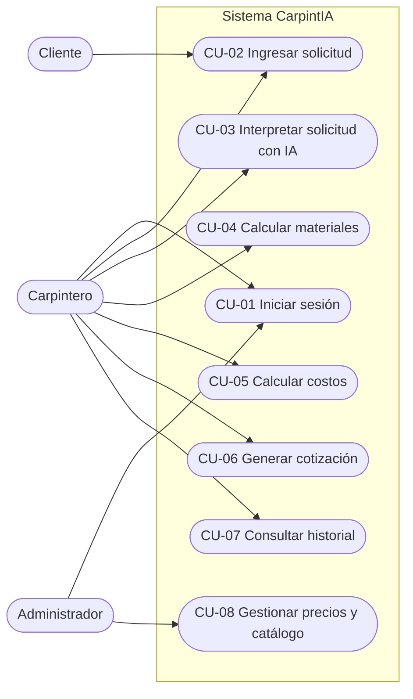
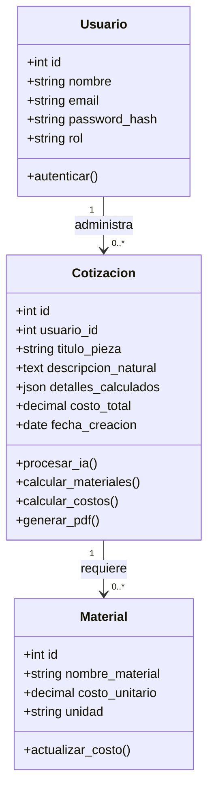
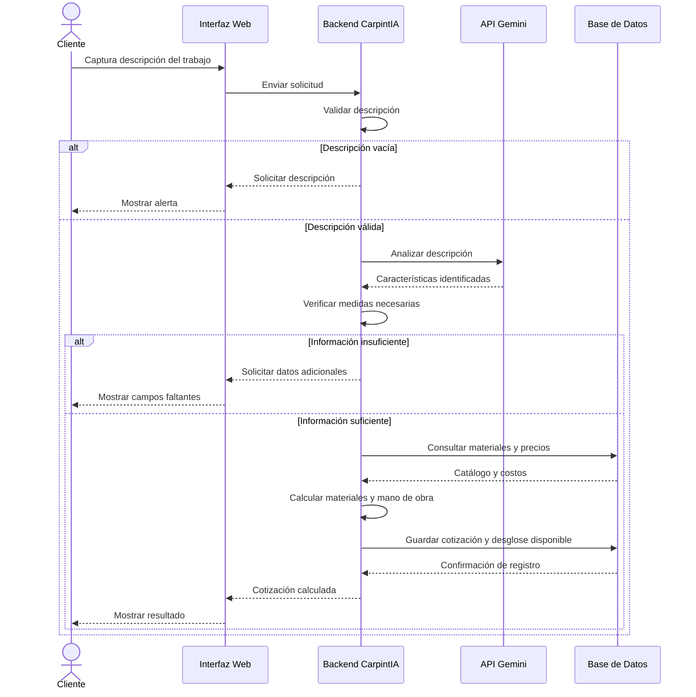
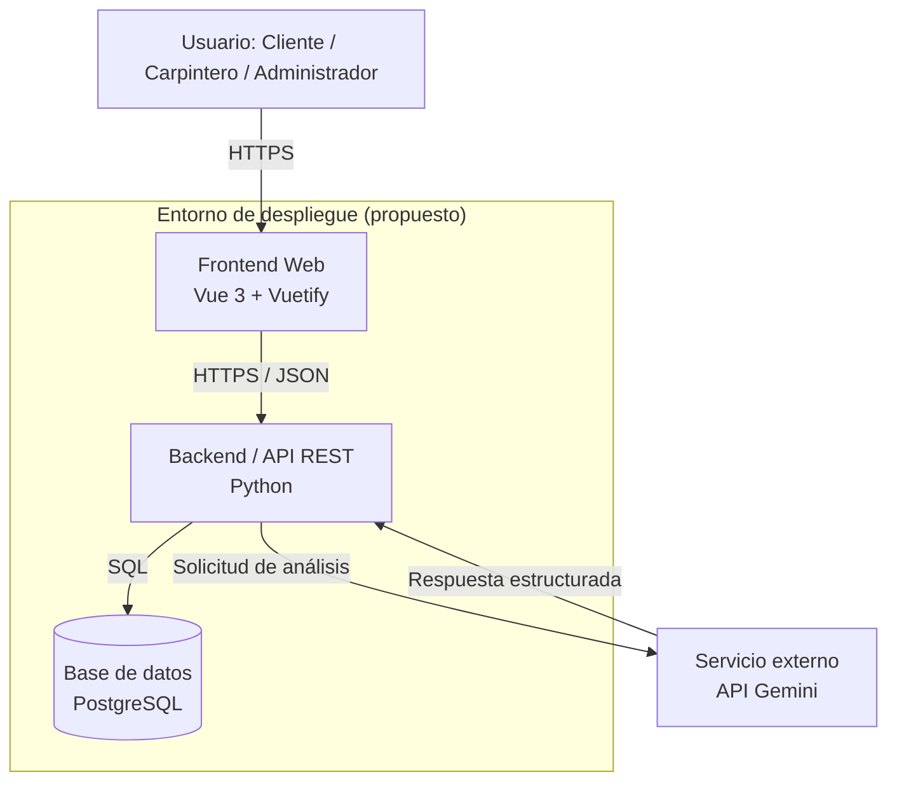
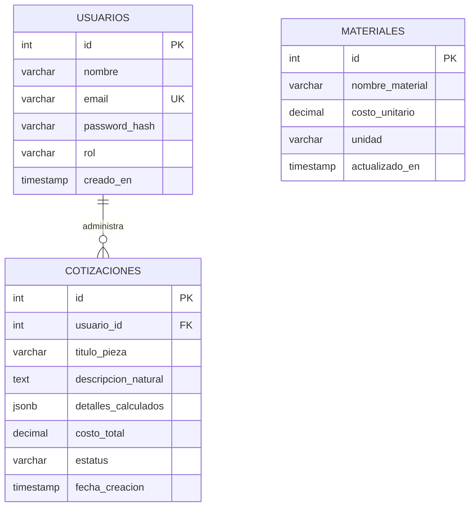

# PORTAFOLIO DE ANÁLISIS Y DISEÑO — CarpintIA

**Asignatura:** Ingeniería de Software / Integración de Proyectos  
**Carrera:** Ingeniería en Datos e Inteligencia Artificial  
**Institución:** Universidad Politécnica de Guanajuato  
**Integrantes identificados en los documentos:** Dominic Torres Juárez, Eder Nieto Aguilar y Pavel Said Rodríguez Mendoza  
**Documento maestro:** PORTAFOLIO_ANALISIS_DISENO.md  
**Unidad:** 2 — Análisis y Diseño

> **Nota de integración:** Este documento reúne y organiza la información de `FACTIBILIDAD_PLANIFICACION.md`, `SRS_IEEE830.md`, `HISTORIAS_USUARIOS.md`, `MODELADO_UML.md`, `schema.sql`, `CALIDAD.md`, `SPRINT_PLANNING.md`, `PARADIGMA.md` y `README.md`. Se conservaron los datos de los archivos fuente. Cuando se agregan propuestas para cubrir un requisito de la práctica, se identifican como **propuesta de diseño** para distinguirlas de los acuerdos ya documentados.

---

# Sección 1. Factibilidad y Planificación

## 1.1 Descripción general del proyecto

**CarpintIA** es una aplicación web inteligente orientada a talleres de carpintería artesanales y medianos. Su objetivo es agilizar la elaboración de cotizaciones mediante la interpretación de solicitudes escritas en lenguaje natural con inteligencia artificial, el cálculo de materiales y costos, y la administración de un historial de presupuestos.

El sistema contempla la captura de la descripción del trabajo solicitado, la extracción de características como dimensiones, tipo de madera y herrajes, el cálculo de materiales y mano de obra, y la generación de una cotización organizada para el cliente.

## 1.2 Estudio de factibilidad técnica

- **Backend:** Python para la lógica de negocio, procesamiento e integración.
- **Frontend:** JavaScript/TypeScript con Vue 3 y Vuetify para construir una interfaz responsiva e interactiva.
- **Base de datos:** SQL Server o PostgreSQL, según el documento de factibilidad. El archivo `schema.sql` entregado utiliza sintaxis de PostgreSQL (`SERIAL`, `JSONB` y `TIMESTAMP`).
- **Inteligencia artificial:** API de Gemini para procesar descripciones de trabajos de carpintería y extraer características relevantes.
- **Herramientas de desarrollo:** Visual Studio Code, Git, GitHub, GitHub Projects y Pylint.
- **Evaluación:** Los documentos fuente consideran alta la factibilidad técnica porque el equipo cuenta con conocimientos de desarrollo web, SQL e integración de APIs REST.

## 1.3 Estudio de factibilidad económica

- Se contempla utilizar servicios de alojamiento gratuitos o de bajo costo, como Render, Vercel o Supabase.
- Para el prototipo se considera utilizar el plan de desarrollo o cuota gratuita de la API de Gemini.
- Las horas de desarrollo serán cubiertas por los integrantes del equipo durante las semanas lectivas.
- **Evaluación documentada:** El proyecto no requiere una inversión inicial significativa y se considera económicamente viable.

## 1.4 Estudio de factibilidad operativa

- El sistema está dirigido a talleres de carpintería y artesanos.
- La captura de solicitudes mediante lenguaje natural busca reducir la curva de aprendizaje.
- Se contempla el tratamiento confidencial de la información de clientes y cotizaciones, considerando la LFPDPPP.
- La automatización del cálculo de presupuestos se plantea de forma paulatina para reducir la resistencia al cambio.

## 1.5 Estructura de desglose del trabajo (EDT / WBS)

La siguiente EDT organiza el trabajo descrito en el cronograma y en las historias del proyecto.



## 1.6 Cronograma y diagrama de Gantt

Se conserva el cronograma del archivo de factibilidad:



## 1.7 Matriz RACI

**R:** Responsable de ejecutar. **A:** Responsable final de la actividad. **C:** Consultado. **I:** Informado.

| Actividad | Dominic | Pavel | Eder |
|---|---:|---:|---:|
| Registro de solicitud (HU-01) | R/A | I | C |
| Interpretación con IA (HU-02) | R/A | I | C |
| Cálculo de materiales (HU-03) | R/A | C | I |
| Costos y mano de obra (HU-04) | C | R/A | I |
| Generación de cotización (HU-05) | I | R/A | C |
| Historial de cotizaciones (HU-06) | I | R/A | C |
| Revisión e integración del documento | R | R/A | C |

**Alcance de la matriz:** La distribución de HU-01 a HU-06 entre Dominic y Pavel proviene del inventario de historias. Eder aparece como integrante en `PARADIGMA.md`, pero los archivos no especifican una asignación individual de historias para él; por ello, su participación como consultado o informado es una propuesta de coordinación y debe validarse con el equipo.

---

# Sección 2. Especificación de Requisitos IEEE 830

## 2.1 Propósito y alcance

CarpintIA busca optimizar y automatizar el proceso de cotización en talleres de carpintería. Interpreta requerimientos de clientes escritos en lenguaje natural mediante la API de Gemini, calcula materiales, dimensiones y herrajes, y administra un historial de costos y presupuestos.

El valor esperado es reducir el tiempo de elaboración de presupuestos, minimizar errores de cálculo de materia prima y mejorar la precisión de las cotizaciones.

## 2.2 Actores del sistema

- **Cliente:** proporciona la descripción del mueble o trabajo requerido.
- **Carpintero:** revisa solicitudes, calcula materiales y costos, genera cotizaciones y consulta el historial.
- **Administrador:** gestiona precios y catálogo y cuenta con permisos de administración.
- **Sistema / API Backend:** procesa solicitudes y se comunica con la API de Gemini.

## 2.3 Requerimientos funcionales

Los RF-01 a RF-04 se basan en el SRS original. Los RF-05 a RF-08 se organizan a partir de las historias de usuario y los casos de uso ya documentados, para alcanzar el mínimo de seis requisitos funcionales solicitado en la práctica.

| Código | Nombre | Descripción | Prioridad | Actor principal |
|---|---|---|---|---|
| RF-01 | Autenticación de usuarios | El sistema permitirá iniciar sesión mediante tokens JWT y controlar el acceso por roles (Administrador / Carpintero). | Alta | Usuario / Administrador |
| RF-02 | Ingesta de solicitudes | El sistema permitirá capturar descripciones textuales o verbales de los trabajos solicitados por los clientes. | Alta | Carpintero / Cliente |
| RF-03 | Procesamiento con IA | El backend enviará la solicitud a Gemini para extraer medidas, tipo de madera, herrajes y otras características relevantes. | Alta | Sistema |
| RF-04 | Generación y consulta de cotizaciones | El sistema permitirá crear cotizaciones estructuradas con desglose de costos, exportarlas a PDF y conservar un historial consultable. | Media | Administrador / Carpintero |
| RF-05 | Validación de solicitud | El sistema verificará que la descripción no esté vacía y solicitará información adicional cuando los datos sean insuficientes. | Alta | Cliente / Sistema |
| RF-06 | Cálculo de materiales | El sistema calculará los materiales y cantidades requeridos cuando disponga de las características y medidas necesarias. | Alta | Carpintero / Sistema |
| RF-07 | Cálculo de mano de obra y costos | El sistema calculará el costo de materiales, mano de obra y costo total; identificará materiales que no tengan precio registrado. | Alta | Carpintero / Sistema |
| RF-08 | Gestión de precios y catálogo | El administrador podrá gestionar los precios y el catálogo de materiales utilizados en los cálculos. | Media | Administrador |

## 2.4 Requerimientos no funcionales

Los tres primeros se conservan del SRS original. El RNF-04 se formula a partir del atributo de aceptabilidad descrito en `CALIDAD.md`.

| Código | Atributo | Requisito verificable | Criterio |
|---|---|---|---|
| RNF-01 | Rendimiento | El procesamiento de una solicitud de cotización mediante la API de IA no deberá exceder 3.5 segundos bajo una carga concurrente estándar. | Tiempo de respuesta ≤ 3.5 s en las condiciones de carga definidas para la prueba. |
| RNF-02 | Seguridad | La comunicación cliente-servidor utilizará HTTPS/TLS 1.3; las contraseñas se almacenarán con hashing robusto (`bcrypt`) y se protegerán los datos de clientes. | Verificación de configuración TLS, almacenamiento de hashes y control de acceso. |
| RNF-03 | Mantenibilidad | El backend y frontend mantendrán una estructura modular y documentada, con al menos 80% de cobertura en pruebas unitarias y de integración. | Cobertura de pruebas ≥ 80%. |
| RNF-04 | Aceptabilidad / Usabilidad | Las funciones principales deberán contar con una interfaz comprensible y documentación breve que facilite su uso por los integrantes y usuarios del sistema. | Revisión de las pantallas principales y documentación de las funciones principales. |

**Nota:** El criterio de RNF-04 es una propuesta de especificación basada en la categoría de aceptabilidad y la documentación de funciones que aparecen en `CALIDAD.md`; no se encontró una métrica numérica de usabilidad en los archivos fuente.

## 2.5 Casos de uso



## 2.6 Descripción breve de casos de uso

| ID | Caso de uso | Actor | Resultado esperado |
|---|---|---|---|
| CU-01 | Iniciar sesión | Carpintero / Administrador | Acceso autorizado según el rol. |
| CU-02 | Ingresar solicitud | Cliente / Carpintero | Solicitud registrada con una descripción válida. |
| CU-03 | Interpretar solicitud con IA | Carpintero / Sistema | Características del trabajo identificadas o petición de información adicional. |
| CU-04 | Calcular materiales | Carpintero | Lista de materiales y cantidades requeridas. |
| CU-05 | Calcular costos | Carpintero | Costos de materiales, mano de obra y total. |
| CU-06 | Generar cotización | Carpintero | Cotización con descripción, materiales, mano de obra y costos. |
| CU-07 | Consultar historial | Carpintero | Lista de cotizaciones previas o aviso de que no existen registros. |
| CU-08 | Gestionar precios y catálogo | Administrador | Precios y materiales disponibles para los cálculos. |

---

# Sección 3. Modelado UML Completo

## 3.1 Diagrama de clases

El diagrama conserva las clases y atributos del archivo `MODELADO_UML.md`. Se complementa con las operaciones y relaciones necesarias para representar el flujo funcional descrito en las historias de usuario.



**Observación de diseño:** La relación Cotización–Material representa el dominio funcional. El `schema.sql` actual no contiene una tabla intermedia para guardar la relación de muchos a muchos ni las cantidades por material; esa parte debe definirse si se requiere persistir el desglose de materiales de cada cotización.

## 3.2 Diagrama de casos de uso

El diagrama general se encuentra en la Sección 2.5. Representa los actores Cliente, Carpintero y Administrador, y las funciones principales de CarpintIA.

## 3.3 Diagrama de secuencia: generación de cotización

Este diagrama se deriva del flujo de las historias HU-01 a HU-05 y del alcance del SRS.



## 3.4 Diagrama de despliegue

**Propuesta de diseño:** La siguiente vista representa la arquitectura tecnológica descrita en el estudio de factibilidad. Los servicios concretos de alojamiento aún se consideran alternativas (Render, Vercel o Supabase), no una selección definitiva.



---

# Sección 4. Diseño de Base de Datos

## 4.1 Modelo entidad-relación

El esquema entregado define tres entidades: `usuarios`, `cotizaciones` y `materiales`. La relación entre usuarios y cotizaciones se implementa mediante `usuario_id`. Los materiales se almacenan en un catálogo independiente.



## 4.2 Modelo de dominio

- **Usuario:** representa a la persona que utiliza el sistema. Contiene nombre, correo, hash de contraseña y rol.
- **Cotización:** almacena el título de la pieza, descripción natural, detalles calculados, costo total, estatus y fecha de creación. Pertenece a un usuario.
- **Material:** representa un material disponible en el catálogo, con costo unitario, unidad y fecha de actualización.

## 4.3 Esquema lógico

| Tabla | Campo | Tipo | Restricciones |
|---|---|---|---|
| usuarios | id | SERIAL | PK |
| usuarios | nombre | VARCHAR(100) | NOT NULL |
| usuarios | email | VARCHAR(150) | UNIQUE, NOT NULL |
| usuarios | password_hash | VARCHAR(255) | NOT NULL |
| usuarios | rol | VARCHAR(30) | DEFAULT 'carpintero' |
| usuarios | creado_en | TIMESTAMP | DEFAULT CURRENT_TIMESTAMP |
| cotizaciones | id | SERIAL | PK |
| cotizaciones | usuario_id | INT | FK a usuarios(id), NOT NULL |
| cotizaciones | titulo_pieza | VARCHAR(150) | NOT NULL |
| cotizaciones | descripcion_natural | TEXT | NOT NULL |
| cotizaciones | detalles_calculados | JSONB | NOT NULL |
| cotizaciones | costo_total | DECIMAL(10,2) | NOT NULL |
| cotizaciones | estatus | VARCHAR(20) | DEFAULT 'generada' |
| cotizaciones | fecha_creacion | TIMESTAMP | DEFAULT CURRENT_TIMESTAMP |
| materiales | id | SERIAL | PK |
| materiales | nombre_material | VARCHAR(100) | NOT NULL |
| materiales | costo_unitario | DECIMAL(10,2) | NOT NULL |
| materiales | unidad | VARCHAR(30) | NOT NULL |
| materiales | actualizado_en | TIMESTAMP | DEFAULT CURRENT_TIMESTAMP |

## 4.4 Script DDL

El siguiente script corresponde al archivo `schema.sql` entregado. Está escrito para PostgreSQL.

```sql
-- Script DDL de Creación del Esquema Relacional de la Base de Datos (CarpintIA)

CREATE TABLE usuarios (
    id SERIAL PRIMARY KEY,
    nombre VARCHAR(100) NOT NULL,
    email VARCHAR(150) UNIQUE NOT NULL,
    password_hash VARCHAR(255) NOT NULL,
    rol VARCHAR(30) DEFAULT 'carpintero',
    creado_en TIMESTAMP DEFAULT CURRENT_TIMESTAMP
);

CREATE TABLE cotizaciones (
    id SERIAL PRIMARY KEY,
    usuario_id INT NOT NULL REFERENCES usuarios(id) ON DELETE CASCADE,
    titulo_pieza VARCHAR(150) NOT NULL,
    descripcion_natural TEXT NOT NULL,
    detalles_calculados JSONB NOT NULL,
    costo_total DECIMAL(10, 2) NOT NULL,
    estatus VARCHAR(20) DEFAULT 'generada',
    fecha_creacion TIMESTAMP DEFAULT CURRENT_TIMESTAMP
);

CREATE TABLE materiales (
    id SERIAL PRIMARY KEY,
    nombre_material VARCHAR(100) NOT NULL,
    costo_unitario DECIMAL(10, 2) NOT NULL,
    unidad VARCHAR(30) NOT NULL,
    actualizado_en TIMESTAMP DEFAULT CURRENT_TIMESTAMP
);
```

## 4.5 Consideraciones y pendientes de base de datos

1. El archivo actual utiliza tipos y funciones de PostgreSQL. Si se selecciona SQL Server, será necesario adaptar el DDL.
2. Para relacionar cotizaciones con múltiples materiales y registrar cantidades, se recomienda diseñar una tabla intermedia `cotizacion_material` con `cotizacion_id`, `material_id`, `cantidad` y `costo_unitario_aplicado`. Esta tabla es una **propuesta**, no forma parte del `schema.sql` original.
3. Conviene definir restricciones para que `costo_unitario` y `costo_total` no acepten valores negativos.
4. El campo `detalles_calculados` permite almacenar información estructurada, pero se debe acordar su formato JSON para que frontend y backend utilicen la misma estructura.

---

# Sección 5. Arquitectura e Interfaces

## 5.1 Patrón arquitectónico propuesto: MVC / arquitectura por capas

Se propone organizar la aplicación con separación de responsabilidades, compatible con el uso de Vue 3 en frontend y Python en backend.

- **Vista (View):** pantallas construidas con Vue 3 y Vuetify. Presentan formularios, resultados de análisis, costos e historial.
- **Controlador (Controller):** recibe las peticiones del frontend, valida los datos de entrada y coordina los servicios del backend.
- **Modelo (Model):** representa usuarios, cotizaciones y materiales, y gestiona el acceso a la base de datos.
- **Capa de servicios:** concentra la lógica de negocio para interpretar solicitudes con Gemini, calcular materiales, calcular costos y generar cotizaciones.

**Justificación:** La separación facilita el mantenimiento, permite modificar la interfaz sin mezclarla con los cálculos y mantiene aislada la integración con Gemini y la base de datos. Esta organización es una propuesta de diseño coherente con las tecnologías descritas en el estudio de factibilidad.

## 5.2 Wireframes de interfaces principales

Los siguientes wireframes son esquemas funcionales de baja fidelidad para definir la distribución de los elementos. No representan capturas de una interfaz ya implementada.

### Pantalla 1. Inicio de sesión

```text
+--------------------------------------------------+
|                    CARPINTIA                     |
|             Sistema de cotizaciones              |
|                                                  |
|                 Iniciar sesión                   |
|                                                  |
|  Correo electrónico                              |
|  [________________________________________]      |
|                                                  |
|  Contraseña                                      |
|  [________________________________________]      |
|                                                  |
|                 [ Ingresar ]                     |
+--------------------------------------------------+
```

### Pantalla 2. Nueva solicitud

```text
+--------------------------------------------------+
| CARPINTIA                  Inicio | Historial    |
+--------------------------------------------------+
|              Nueva solicitud                    |
|                                                  |
| Describe el mueble o trabajo que necesitas:      |
| [                                              ] |
| [                                              ] |
| [                                              ] |
|                                                  |
|       [ Analizar solicitud con IA ]              |
|                                                  |
| Resultado de interpretación:                     |
| Tipo de mueble: __________________________       |
| Medidas: _________________________________       |
| Material: ________________________________       |
| Herrajes: ________________________________       |
|                                                  |
|       [ Confirmar datos ]                        |
+--------------------------------------------------+
```

### Pantalla 3. Cálculo y generación de cotización

```text
+--------------------------------------------------+
| CARPINTIA                  Inicio | Historial    |
+--------------------------------------------------+
|              Resumen de cotización               |
|                                                  |
| Descripción del trabajo: __________________      |
|                                                  |
| Materiales             Cantidad       Importe    |
| __________________     ________       _______    |
| __________________     ________       _______    |
| __________________     ________       _______    |
|                                                  |
| Costo de materiales:                  $_______   |
| Mano de obra:                         $_______   |
| Costo total:                           $_______   |
|                                                  |
| [ Recalcular ]       [ Generar PDF ]              |
+--------------------------------------------------+
```

### Pantalla 4. Historial de cotizaciones

```text
+--------------------------------------------------+
| CARPINTIA                  Inicio | Nueva        |
+--------------------------------------------------+
|              Historial de cotizaciones           |
|                                                  |
| Buscar: [____________________________]           |
|                                                  |
| Folio | Trabajo       | Fecha      | Total       |
| ------|---------------|------------|-------------|
| 001   | Closet        | dd/mm/aaaa | $________   |
| 002   | Mesa          | dd/mm/aaaa | $________   |
| 003   | Puerta        | dd/mm/aaaa | $________   |
|                                                  |
|             [ Consultar detalle ]                |
+--------------------------------------------------+
```

## 5.3 Especificación propuesta de endpoints REST

Los siguientes endpoints son una propuesta de interfaz entre frontend y backend. Los documentos fuente describen las funciones del sistema, pero no contienen rutas REST definitivas.

| Método | Endpoint propuesto | Función | Acceso |
|---|---|---|---|
| POST | `/api/auth/login` | Iniciar sesión y obtener token JWT. | Público |
| POST | `/api/solicitudes` | Registrar una solicitud de trabajo. | Carpintero / Cliente |
| POST | `/api/solicitudes/{id}/interpretar` | Enviar la descripción a Gemini y obtener datos interpretados. | Carpintero |
| POST | `/api/cotizaciones/calcular-materiales` | Calcular materiales y cantidades necesarias. | Carpintero |
| POST | `/api/cotizaciones/calcular-costos` | Calcular materiales, mano de obra y costo total. | Carpintero |
| POST | `/api/cotizaciones` | Guardar una cotización. | Carpintero |
| GET | `/api/cotizaciones` | Consultar el historial de cotizaciones. | Carpintero |
| GET | `/api/cotizaciones/{id}` | Consultar el detalle de una cotización. | Carpintero |
| GET | `/api/materiales` | Consultar el catálogo de materiales. | Carpintero / Administrador |
| POST | `/api/materiales` | Registrar un material. | Administrador |
| PUT | `/api/materiales/{id}` | Actualizar el precio o datos de un material. | Administrador |
| GET | `/api/cotizaciones/{id}/pdf` | Obtener la cotización en PDF. | Carpintero |

### Ejemplo de respuesta JSON para interpretación

```json
{
  "tipo_mueble": "closet",
  "numero_puertas": 3,
  "material_principal": "madera de pino",
  "medidas": null,
  "requiere_informacion_adicional": true,
  "datos_faltantes": ["alto", "ancho", "profundidad"]
}
```

El ejemplo es ilustrativo: el formato definitivo de respuesta de Gemini debe acordarse e implementarse en el backend.

## 5.4 Estándares y atributos de calidad

Se integran los criterios documentados en `CALIDAD.md`:

- **Mantenibilidad:** código ordenado, dividido en funciones sencillas, nombres claros y uso de PEP 8 para Python.
- **Confiabilidad y seguridad:** validación de entradas y protección de contraseñas, credenciales y datos sensibles.
- **Eficiencia:** uso de estructuras adecuadas y reducción de operaciones innecesarias durante el procesamiento.
- **Aceptabilidad:** documentación breve de las funciones principales para facilitar la comprensión del equipo.

## 5.5 Gestión de configuración y trabajo colaborativo

De acuerdo con `PARADIGMA.md`:

- **IDE:** Visual Studio Code.
- **Control de versiones:** Git y GitHub.
- **Linter:** Pylint para revisar código Python.
- **Gestión de tareas:** GitHub Projects con tablero Kanban.
- **Commits:** utilizar prefijos como `feat:`, `fix:`, `docs:` y `refactor:`.
- **Ramas:** no realizar push directo a `main`; los cambios se trabajan en ramas `feature/*`.
- **Pull Requests:** cada PR requiere la aprobación escrita de al menos un integrante antes del merge.

## 5.6 Planeación del Sprint 1

**Meta del Sprint:** construir el flujo inicial de solicitud de cotización, procesamiento con IA y motor de cálculo base para estimación de materiales y costos.

| Historia | Módulo | Estimación en Sprint Planning | Responsable |
|---|---|---:|---|
| HU-01 | Solicitud del cliente | 5 pts | Dominic |
| HU-02 | Inteligencia Artificial | 8 pts | Dominic |
| HU-03 | Cálculo de materiales | 5 pts | Dominic |
| HU-04 | Costos y mano de obra | 5 pts | Pavel |

### Definition of Ready (DoR)

Una historia puede entrar al Sprint cuando:
- Tiene criterios de aceptación redactados en Gherkin (`Given-When-Then`).
- Cuenta con estimación en Story Points aprobada por el equipo.
- Tiene resueltas las dependencias técnicas y preliminares de base de datos.
- Cuenta con modelos o especificaciones técnicas necesarias para su desarrollo.

### Definition of Done (DoD)

Una historia se considera terminada cuando:
- El código fue revisado y aprobado mediante Peer Review en un Pull Request.
- Cumple con el linter del proyecto sin errores.
- Los criterios de aceptación Gherkin fueron validados.
- El código está integrado en la rama principal (`main` / `develop`).

---

# Observaciones de integración y pendientes por validar

Antes de entregar el portafolio, el equipo debe revisar los siguientes puntos detectados al comparar los archivos:

1. **Nombre del proyecto:** `PARADIGMA.md` identifica el proyecto como “Análisis de Datos”, mientras que el SRS, UML y la base de datos corresponden a “CarpintIA”. Este documento utiliza CarpintIA porque es el sistema descrito por la mayoría de los entregables; conviene corregir el archivo `PARADIGMA.md` si se trata de un dato desactualizado.
2. **Estimaciones de historias:** `HISTORIAS_USUARIOS.md` asigna 3 puntos a HU-01, 8 a HU-02, 8 a HU-03, 5 a HU-04, 5 a HU-05 y 3 a HU-06. `SPRINT_PLANNING.md` asigna 5, 8, 5 y 5 puntos a HU-01 a HU-04. Se conservaron las estimaciones de cada fuente en sus apartados; el equipo debe acordar cuál es la estimación vigente.
3. **Integrante Eder:** aparece en `PARADIGMA.md`, pero no tiene historias asignadas en el inventario. La matriz RACI lo incluye como consultado/informado de manera provisional.
4. **Base de datos:** el DDL es PostgreSQL, aunque el estudio de factibilidad menciona SQL Server o PostgreSQL. Debe elegirse el motor definitivo.
5. **Relación de materiales:** el diagrama de clases representa materiales requeridos por una cotización, pero el esquema SQL todavía no almacena cantidades por cotización. Se recomienda agregar y validar una tabla intermedia.
6. **Diagramas adicionales:** el archivo UML original solo contenía el diagrama de clases. El diagrama de secuencia y el de despliegue incluidos aquí son propuestas derivadas del flujo funcional y de la arquitectura descrita; deben revisarse con el equipo.
7. **Requisitos ampliados:** el SRS original incluía cuatro RF y tres RNF. Se añadieron RF y RNF para alcanzar los mínimos de la práctica, procurando derivarlos de las historias y de la matriz de calidad.

---

## Archivos fuente integrados

- `README.md`
- `PARADIGMA.md`
- `FACTIBILIDAD_PLANIFICACION.md`
- `SRS_IEEE830.md`
- `HISTORIAS_USUARIOS.md`
- `MODELADO_UML.md`
- `schema.sql`
- `CALIDAD.md`
- `SPRINT_PLANNING.md`
